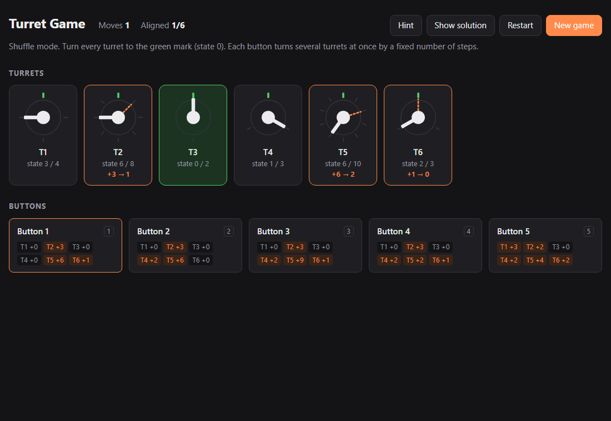
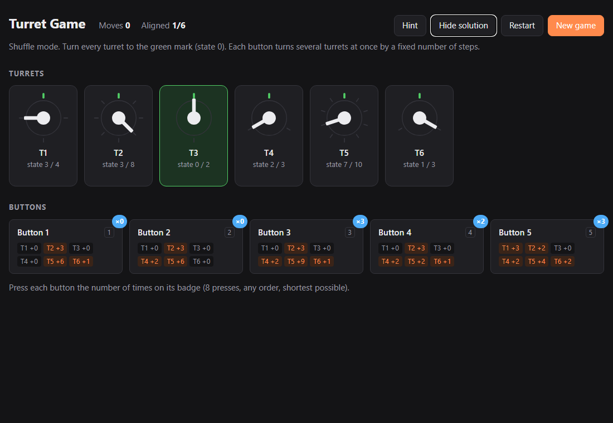
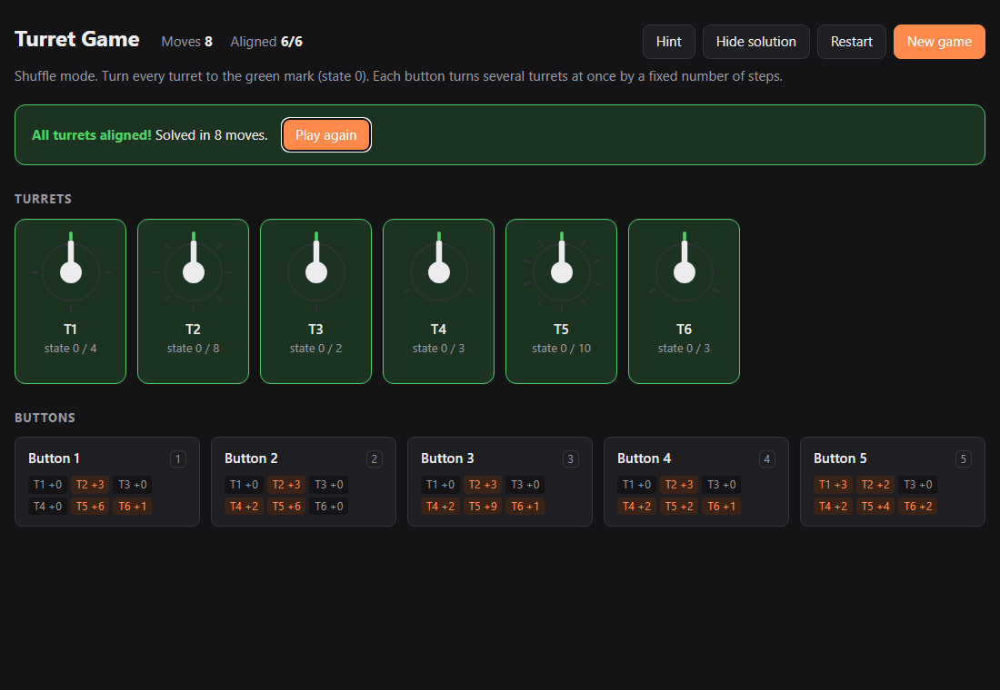

# Turret Game

A puzzle game where every button turns several turrets at once. Bring **all turrets to position 0** to win.



## How it works

- There are 3 to 10 **turrets**. Each one is a dial with between 2 and 10 positions (`0 … n-1`) and wraps around after the last one.
- There are 3 to 10 **buttons**. Each button turns *every* turret forward by its own fixed number of steps (sometimes 0).
- You win when every turret points at **0** (the green mark).

Turrets wrap around, so you can never "overshoot". The challenge is that each press also moves turrets you have already lined up.

## Getting started

Requires Python 3.8+ and nothing else. No packages to install; everything uses the standard library.

### Web interface (recommended)

```bash
python server.py
```

Your browser opens at <http://127.0.0.1:8000>. Use `127.0.0.1` rather than `localhost`: on Windows, `localhost` tries IPv6 first and every click becomes noticeably slower.

### Terminal version

```bash
python main.py
```

Type a button number to press it, `s` to print a solution, or `q` to quit.

## Web interface features

| | |
|---|---|
| **Dials** | Each turret shows its positions as tick marks, with 0 highlighted in green. A turret's card turns green once it's at 0. |
| **Hover preview** | Hovering a button (or focusing it with the keyboard) outlines the turrets it moves and draws a dashed line where each one will land. |
| **Keyboard** | Keys `1`–`9` and `0` press buttons 1 to 10. |
| **Hint** | Highlights one button that is part of a solution. |
| **Show solution** | Shows how many times to press each button. The order doesn't matter. |
| **Restart / New game** | Restart puts the current board back to its starting position; New game deals a new board. |





## The math behind it

Pressing button `j` a total of `x_j` times moves turret `i` (which has `n_i` positions and starts at `s_i`) to

```
s_i + a_i1·x_1 + a_i2·x_2 + … + a_ik·x_k   (mod n_i)
```

where `a_ij` is how far button `j` turns turret `i`. Solving the puzzle means solving this system of linear congruences, which has **a different modulus on each row**:

```
a_i1·x_1 + … + a_ik·x_k ≡ −s_i   (mod n_i)     for every turret i
```

The order of presses doesn't matter (buttons commute); only how many times each one is pressed.

### Solvability: integer Gauss-Jordan (`Game.game_solution`)

Ordinary Gauss-Jordan elimination needs division, and division isn't available modulo `n` (for example, 2 has no inverse mod 4). Instead the solver:

1. Adds one unknown `y_i` per turret for its wrap-arounds. This turns the congruences into one exact integer system `[A | diag(n)] · [x; y] = −s`.
2. Brings that matrix to lower-triangular **Hermite normal form** using column operations built from the extended GCD. These are the integer equivalent of pivoting, and they can always be undone, so no solutions are gained or lost.
3. Solves the triangular system by forward substitution. If a pivot doesn't divide its right-hand side, the position has **no solution**.

This answer is always correct, but it can be much longer than necessary.

### Shortest solution: bidirectional search (`Game.shortest_solution`)

To find the fewest presses, the game searches from the current position and from the solved position at the same time, one layer at a time, until the two searches meet. Because buttons commute, the number of distinct positions within a few presses stays small, so this is fast on almost every board.

`Game.best_solution` puts the two together: Gauss-Jordan decides whether a solution exists, and the search finds the shortest one. On very large boards the search stops at a size limit, and the game falls back to the Gauss-Jordan answer, which is valid but longer. The UI only says "shortest possible" when the search succeeded.

### Board generation

A random starting position is usually **unsolvable**: the buttons rarely reach every combination of positions. So shuffle mode starts from the solved board and presses random buttons a random number of times. Every board can therefore be solved.

## Project structure

```
main.py             game logic (Turret, Button, Game), solvers, terminal version
server.py           small HTTP server and JSON API for the web interface
static/index.html   the web interface (HTML, CSS and JavaScript in one file)
docs/screenshots/   images used in this README
```

### API

The page talks to `server.py` with JSON `POST` requests:

| Endpoint | Body | Returns |
|---|---|---|
| `/api/new` | `{}` | new game id + board |
| `/api/press` | `{"id", "button"}` | updated board (`button` is a 0-based index) |
| `/api/reset` | `{"id"}` | board back at its starting position |
| `/api/solve` | `{"id"}` | `{"solvable", "shortest", "presses": [...]}` |

Games are kept in memory, so they are lost when the server stops.

## Game modes

- **Shuffle** – random turrets, random buttons, random (always solvable) starting position.
